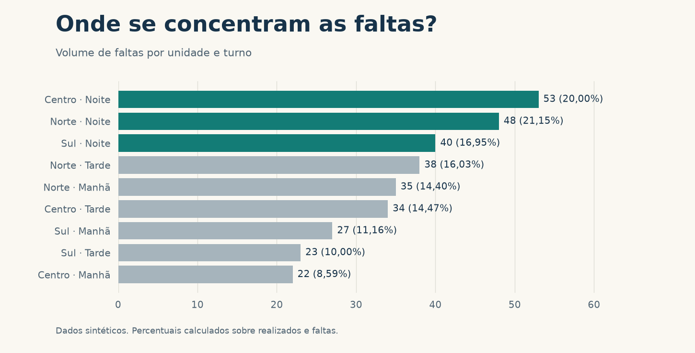

# Portfólio de Dados e BI

Dois estudos com Python, Oracle SQL e Power BI. Cada caso parte de uma pergunta, documenta suas regras de negócio e entrega dados processados, testes e uma visualização.

[Relatório editável em Power BI](agenda-analytics/power-bi/) · [LinkedIn](https://www.linkedin.com/in/eduardo-oliveirapereira/) · [eduardooliveira0629@gmail.com](mailto:eduardooliveira0629@gmail.com)

| Estudo | Resultado | Ferramentas |
| --- | --- | --- |
| [Faltas em agendamentos](agenda-analytics/) | Na agenda fictícia, Centro à noite teve mais faltas (53). Norte à noite teve a maior taxa (21,15%). A prioridade muda conforme o objetivo da operação. | Oracle SQL e Power BI |
| [IPCA e Selic](indicadores-bcb/) | Em dezembro de 2025, o IPCA acumulado em 12 meses foi de 4,26%. A análise cruza 72 meses de dados do Banco Central e confere o resultado com o IBGE. | Python e Oracle SQL |



Minha base em Java aparece no [Defesa Ribeirinho](defesa-ribeirinho/), com um exemplo executável sobre confirmação de alertas e ocupação de abrigos. A [consulta de vendas por vendedor](pratica-vendas.sql) retoma um exercício de Java/JDBC da faculdade.

## Como reproduzir as análises

Os resultados e gráficos estão disponíveis em cada pasta. Para recalcular os indicadores, use Python 3.10 ou superior, o driver oficial e uma conexão Oracle com suporte a JSON_TABLE. Os scripts executam apenas consultas SELECT. Os dados são enviados como parâmetros, sem criar objetos no banco.

No PowerShell, a partir da raiz do repositório:

```powershell
python -m pip install -r requirements.txt
$env:ORACLE_USER = "seu_usuario"
$env:ORACLE_DSN = "servidor:1521/servico"
python agenda-analytics/analisar_agenda.py
python indicadores-bcb/analisar_indicadores.py
```

Digite a senha no terminal quando o script pedir. Para reconstruir as figuras a partir dos CSVs, instale `matplotlib` e execute [gerar_graficos.py](ferramentas/gerar_graficos.py).

Os projetos foram preparados com assistência de IA para estudo. As fontes, as regras de cálculo e os resultados acompanham o código.
