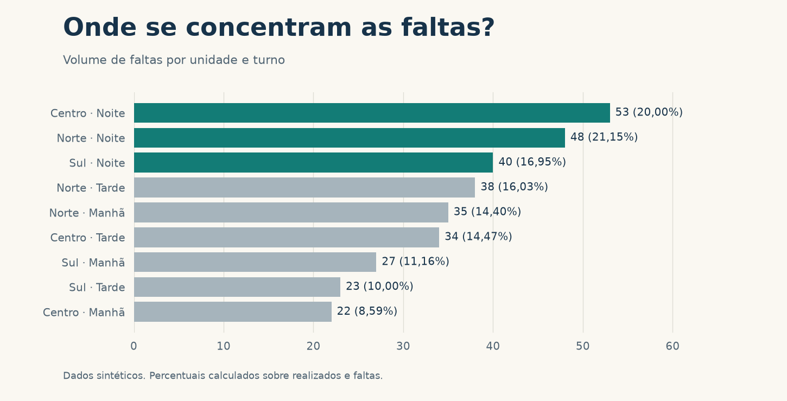

# Agenda Analytics

Estudo de BI operacional em uma rede fictícia de atendimento. A pergunta é **em quais combinações de unidade e turno investigar primeiro as faltas a agendamentos?**

[Painel de agendamentos em Power BI](power-bi/)

## O que aparece no cenário

No conjunto de **2.400 agendamentos**, houve **320 faltas** e **229 cancelamentos**. A taxa de falta foi de **14,74% entre os 2.171 agendamentos elegíveis**.

| Segmento | Faltas | Elegíveis | Taxa |
| --- | ---: | ---: | ---: |
| Centro à noite | 53 | 265 | 20,00% |
| Norte à noite | 48 | 227 | 21,15% |
| Sul à noite | 40 | 236 | 16,95% |

Centro à noite seria o primeiro recorte a investigar se a meta fosse recuperar o maior número de horários. Norte à noite entraria primeiro se a meta fosse reduzir a maior taxa. Numa operação real, a investigação começaria pela qualidade do registro de desfechos e pela diferença de composição entre unidades e turnos.

## Regras e modelo

- **Grão**: uma linha por agendamento. Cada agendamento tem um desfecho, um turno e uma unidade.
- **Elegíveis**: realizados e faltas. Cancelamentos são acompanhados à parte.
- **Taxa de falta**: faltas divididas por elegíveis. Um grupo sem elegíveis retorna valor nulo.
- **Qualidade**: identificadores únicos, unidades e desfechos válidos e conferência do denominador com a base publicada.

Toda a base é **sintética**, gerada com uma semente fixa. O gerador embute diferenças entre turnos e unidades para permitir a prática de segmentação. Os números descrevem um exercício e o estudo não mede efeito de lembretes ou de outra intervenção.

Conferência no Oracle SQL Developer com a base publicada: o resumo geral, os seis meses e os nove segmentos coincidiram com os resultados disponíveis nesta pasta.

## Reproduzir

Configure a [conexão Oracle](../README.md#como-reproduzir-as-análises). Execute `python analisar_agenda.py` nesta pasta. O script envia os registros fictícios ao Oracle. A [base da consulta](modelo.sql) transforma cada agendamento em uma linha e marca as faltas e os elegíveis. A mesma consulta calcula o resumo geral, os resultados mensais e os segmentos por unidade e turno. O Python exporta cada recorte.

[Agendamentos](resultados/agendamentos.csv) · [Resumo](resultados/resumo.json) · [Por unidade e turno](resultados/segmentos.csv) · [Por mês](resultados/mensal.csv)

Para conferir a base publicada e as regras de validação sem uma conexão, execute `python -m unittest -v` nesta pasta.
