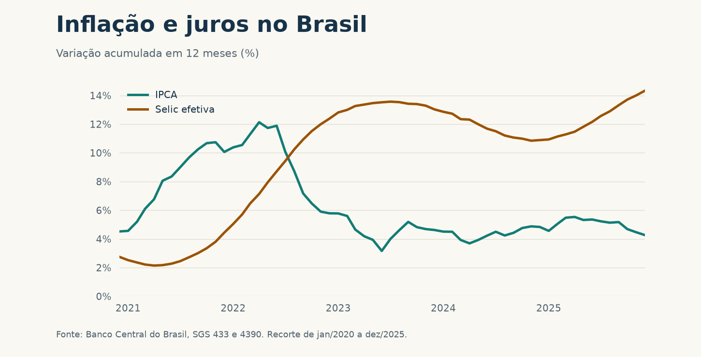

# IPCA e Selic em 12 meses

Pipeline que extrai duas séries do Sistema Gerenciador de Séries Temporais do Banco Central e publica uma tabela mensal pronta para análise. O recorte tem **72 meses**, de janeiro de 2020 a dezembro de 2025.



## Leitura dos resultados

| Dezembro de 2025 | No mês | Em 12 meses |
| --- | ---: | ---: |
| IPCA | 0,33% | 4,26% |
| Selic efetiva | 1,22% | 14,33% |

O IPCA calculado reproduz, com duas casas decimais, o [resultado divulgado pelo IBGE](https://agenciadenoticias.ibge.gov.br/agencia-sala-de-imprensa/2013-agencia-de-noticias/releases/45612-ipca-vai-a-0-33-em-dezembro-e-fecha-o-ano-em-4-26). As séries descrevem grandezas diferentes. O gráfico permite comparar trajetórias em um mesmo horizonte. Para explicar causalidade ou estimar juro real seria preciso outro modelo.

## Como funciona

1. O Python lê a resposta da API ou o recorte versionado em [dados/](dados/).
2. Padroniza a chave para `AAAA-MM`. Rejeita meses duplicados, taxas inválidas, lacunas e cobertura divergente.
3. Em SQL, um `JOIN` pelo mês coloca IPCA e Selic lado a lado. O Python percorre os últimos 12 meses e multiplica os fatores de variação. Dois meses de 1% acumulam 2,01%, pois `1,01 × 1,01 = 1,0201`.
4. O [CSV final](resultados/indicadores.csv) tem uma linha por mês. Os primeiros 11 meses ficam sem acumulado por terem histórico insuficiente no recorte.

## Reproduzir

Na pasta deste projeto, com Python 3.10 ou superior:

```bash
python pipeline.py
python -m unittest -v
```

`python pipeline.py --atualizar` consulta novamente a API para o mesmo período. A primeira execução usa os snapshots locais e funciona offline. No Power BI ou no Excel, importe o CSV como UTF-8, com vírgula como delimitador e ponto como separador decimal.

**Fontes:** Banco Central do Brasil, [IPCA mensal, SGS 433](https://www3.bcb.gov.br/sgspub/consultarmetadados/consultarMetadadosSeriesInternet?method=consultarMetadadosSeriesInternet&hdOidSerieSelecionada=433) e [Selic acumulada no mês, SGS 4390](https://dadosabertos.bcb.gov.br/dataset/4390-taxa-de-juros---selic-acumulada-no-mes). A série 4390 é Selic efetiva mensal. O catálogo do BCB informa licença ODbL para essa série. Os arquivos JSON preservam as respostas da API com atribuição à fonte.
